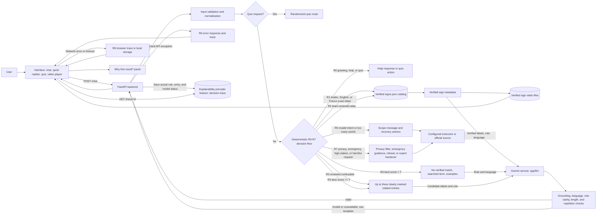

# CoMind Architecture

## Week 5 System Flow

## Explainability Feature

The decision trace is the principle feature. It records normalized input, rule, scores, threshold, results, safeguards, and model-use status. The interface reads that same trace for the `Why this result?` panel. Gemini receives only the rule, reply language, and catalog-backed labels; it cannot choose a sign or video. Its response must pass language, grounding, and rule-clarity checks; otherwise the backend uses its deterministic response template.

## Rule Outcomes and Trace Fields

| Rule | Decision | User outcome | Trace |
| --- | --- | --- | --- |
| R0 | Greeting, help, or quiz request | Help response or quiz action | Detected intent and decision checks |
| R1 | Normalized input equals an Arabic, English, or Franco label | Verified video and `Exact match` badge | Matched field, entry ID, video URL |
| R2 | Normalized input equals a team-reviewed alias | Verified video and `Exact match (alternative word)` badge | Matched alias, entry ID, video URL |
| R3 | No exact match; character similarity score is at least `T = 0.70` | Up to three entries marked `Related, not the same word`; note from index or generic reason | Scores, threshold, entries, matched terms, relation notes |
| R4 | Best score is below `T` | No-match message, searched term, examples, optional handover | Best candidate and score, threshold, searched term |
| R5 | Input is not a short word/phrase or supported intent | Scope message and recovery actions | Detected intent and reason |
| R6 | Backend, Gemini, network, or timeout problem | Calm fallback and retry/edit/reset actions; a catalog result remains visible if only Gemini failed | Error type and route; model issue in trace; browser recovery when backend is unreachable |
| R7 | Personal data, emergency, high-stakes interpretation, or harmful request | Remove personal data, provide emergency guidance, hand over to a qualified interpreter, or refuse harmful assistance | Triggered safeguard and safe response action |

R3 uses normalized character-string similarity, not semantic similarity. Add reviewed notes to a sign record using `"relations": [{"term": "<input term>", "note": "<team-written reason>"}]`; without a matching note, the UI says `related but not the same word`. Review `T` against the team's examples before presenting similarity scores as meaningful.
