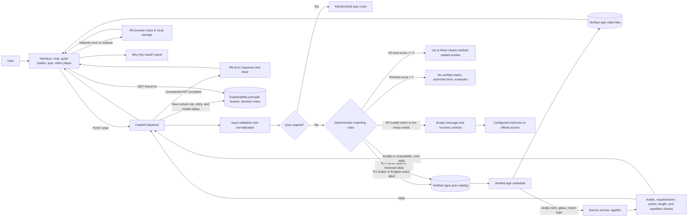

# CoMind Architecture

## Week 5 System Flow

## Explainability Feature

The decision trace is the principle feature. It records the normalized input, rule, matched entry, video URL, and model-use status. The interface reads that same trace for the `Why this result?` panel. The language model receives the already verified Arabic and English sign labels, must mention the Arabic label, and may only write a short learning-focused reply. It never chooses a video, result type, or sign meaning.

## Rule Outcomes and Trace Fields

| Rule | Decision | User outcome | Trace |
| --- | --- | --- | --- |
| R1 | Normalized input equals an Arabic or English label | Verified video and `Exact match` badge | Matched field, entry ID, video URL |
| R2 | Normalized input equals a Franco label or reviewed alias | Verified video and `Exact match (alternative word)` badge | Matched field, explicit matched alias, entry ID, video URL |
| R3 | No exact match; character similarity score is at least `T = 0.72` | Up to three entries marked `Related, not the same word`; note from index or generic reason | Scores, threshold, entries, matched terms, relation notes |
| R4 | Best score is below `T` | No-match message, searched term, example chips, optional handover | Best candidate and score, threshold, searched term, examples |
| R5 | Search text is not word-like, exceeds four words, or fails chat validation; quiz requests are routed separately | Scope message with recovery actions; quiz requests open the quiz | Detected intent and reason |
| R6 | Backend exception, Gemini API/response failure, network failure, or timeout | Calm error message and a retry that resubmits the original word; a valid sign result remains visible if only Gemini failed | Error type and route on backend; Gemini issue nested in the result trace; browser error record when backend is unreachable |

R3 uses normalized character-string similarity, not semantic similarity. Add reviewed notes to a sign record using `"relations": [{"term": "<input term>", "note": "<team-written reason>"}]`; without a matching note, the UI says `related but not the same word`. Review `T` against the team's examples before presenting similarity scores as meaningful.
