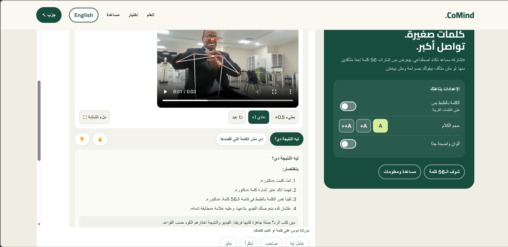

# ISHARA — Egyptian Sign Language Learning Assistant

**Team:** CoMind  
**Project:** HCAI Human–AI Interaction Term Project  
**Tagline:** Breaking Barriers, Expanding Access.

ISHARA helps Arabic-speaking beginners explore Egyptian Sign Language through a searchable library of sign videos and a short interactive quiz. Search results come from the team's sign catalog; Gemini can provide a short, learning-focused response only after a verified sign is found.

## Features

- Search using Arabic, English, Franco-Arabic, and reviewed aliases.
- Display catalog-backed sign labels, explanations, and local videos.
- Apply the full R0–R7 decision flow: help, exact labels, reviewed aliases, related candidates, no match, out-of-scope input, system errors, and safety handover.
- Show a decision trace through the **Why this result?** control.
- Practice with a randomized sign-video quiz, score progress, and retry.
- Offer recovery actions and optional handover to a configured instructor or official resource.
- Use Gemini through the FastAPI backend; generated text does not select signs or videos.

Related suggestions use normalized character similarity with threshold `0.70`; this is not semantic similarity. A related candidate is never presented as the answer to the searched term. Franco labels belong to R1; team-reviewed aliases belong to R2.

## Architecture

The bilingual browser interface (`frontend/index.html`, `style.css`, and `script.js`) sends chat, alternatives, feedback, and quiz requests to the FastAPI backend (`backend/`).

The backend validates and normalizes input, applies deterministic safeguards and matching rules against `backend/signs.json` and reviewed data in `backend/aliases.json`, serves videos from `dataset/`, and records bounded in-memory traces plus JSONL audit records.

Gemini can rephrase R1–R4 responses using verified facts; it cannot choose a sign or video. A validated template remains available if Gemini is unavailable or returns off-topic text.

See [ARCHITECTURE.md](ARCHITECTURE.md) for the system diagram and [WEEK5_DELIVERABLES.md](WEEK5_DELIVERABLES.md) for the conversation flow, Golden Rules checklist, model-demo status, and prompt log.

## Project Structure

```text
HCAI_Project/
├── ARCHITECTURE.md
├── WEEK5_DELIVERABLES.md
├── README.md
└── ISHARA/
    ├── .env.example
    ├── requirements.txt
    ├── backend/
    │   ├── main.py
    │   ├── signs.json
    │   ├── aliases.json
    │   ├── evaluation_test_set.csv
    │   ├── run_evaluation.py
    │   └── app/
    │       ├── api/
    │       ├── core/
    │       ├── domain/
    │       ├── llm/
    │       └── services/
    ├── frontend/
    │   ├── index.html
    │   ├── style.css
    │   └── script.js
    ├── dataset/
    │   └── Local sign videos
    └── screenshots/
        └── principle-feature.png
```

## Getting Started

### Requirements

- Python 3.11 or newer.
- A modern web browser.
- A Google AI Studio API key for Gemini-generated replies (optional for catalog search and quiz).

### Installation

From the repository root, open a terminal and run:

```powershell
cd ISHARA
python -m venv .venv
.\.venv\Scripts\Activate.ps1
python -m pip install --upgrade pip
pip install -r requirements.txt
Copy-Item .env.example .env
```

Open the `.env` file and set the following variable if Gemini-generated replies are needed:

```env
GEMINI_API_KEY=your_api_key_here
```

The API key is optional. Catalog-based sign search and the quiz can work without it.

The default Gemini model is `gemini-3.5-flash-lite`. The `GEMINI_MODEL` environment variable can override it with another model available to the configured Google AI Studio key.

If the key was rotated after exposure, set `GEMINI_KEY_ROTATED_AT` to the rotation date in `YYYY-MM-DD` format.

Do not commit `.env` or expose API keys in the repository.

Set `HUMAN_HANDOVER_URL` to a verified instructor or official resource if you want the handover action to open a destination.

### Running the Backend

From the `ISHARA` directory, activate the virtual environment if it is not already active, then run:

```powershell
python -m uvicorn backend.main:app --reload
```

The backend API is available at:

`http://127.0.0.1:8000`

Interactive API documentation:

`http://127.0.0.1:8000/docs`

### Running the Frontend

Open a second terminal in the `ISHARA` directory and run:

```powershell
python -m http.server 5500 --directory frontend
```

Open the application in your browser:

`http://127.0.0.1:5500`

Keep both terminal windows running while using the application.

## Checkpoint Evidence — November 29, 2026

**1. End-to-end execution:** The prototype runs from the repository using the installation and startup instructions above. Gemini-generated replies require the optional `GEMINI_API_KEY` in `ISHARA/.env`; catalog search and quiz do not require this key.

**2. Principle feature:** The Explainability feature, available through the **Why this result?** control, is live in the running application.



## Principle Feature — Explainability

ISHARA provides an explanation for search results through the **Why this result?** feature.

Instead of displaying only a matching sign, the application provides a decision trace that helps users understand why the result was selected. This improves transparency and helps users understand the system's behavior.

## AI Model and External Services

- **Backend framework:** FastAPI.
- **AI service:** Google Gemini API through the Google GenAI client.
- **Default model:** `gemini-3.5-flash-lite`.
- **API key:** `GEMINI_API_KEY`, stored in the `ISHARA/.env` file. It is optional for catalog search and quiz.
- **Sign matching:** Deterministic catalog-based matching and reviewed aliases. Gemini does not select signs or videos.

## API Endpoints

| Method | Path | Purpose |
|---|---|---|
| `POST` | `/chat` | Search the sign catalog and return the result, trace ID, and optional grounded model reply. |
| `POST` | `/alternatives` | Ask for the next candidate without repeating suggestions already shown. |
| `GET` | `/signs` | Browse the catalog. |
| `GET` | `/quiz` | Get randomized quiz questions and distinct distractors from the full catalog. |
| `GET` | `/trace/{trace_id}` | Retrieve the decision trace for a response. |
| `POST` | `/feedback` | Submit feedback on a result; feedback is appended to the JSONL audit log. |
| `GET` | `/models` | List Gemini models available to the configured key. |
| `GET` | `/videos/{path}` | Serve a catalog video. |

## Evaluation

The 40-case prompt set and runner are in:

- `ISHARA/backend/evaluation_test_set.csv`
- `ISHARA/backend/run_evaluation.py`

Run the evaluator from the `ISHARA` directory:

```powershell
python backend\run_evaluation.py
```

Or, from the `ISHARA/backend` directory:

```powershell
python run_evaluation.py
```

Without `--url`, the runner uses FastAPI's in-process `TestClient`. To evaluate a backend that is already running, pass its URL:

```powershell
python backend\run_evaluation.py --url http://127.0.0.1:8000
```

Each run writes detailed JSONL results and a JSON summary to `ISHARA/backend/evaluation_outputs/`. These generated reports are ignored by Git.

The backend's JSONL audit logs are stored outside the source tree under the operating system's temporary `ishara/logs/` directory by default. Set `ISHARA_DATA_DIR` to choose a persistent data directory outside the project.

## Scope and Limitations

ISHARA is a learning prototype, not an authoritative translation service. Its verified results are limited to the included sign catalog, and related suggestions are approximate character-similarity matches rather than semantic matches.

The system does not recognize arbitrary sign-language videos or translate every Egyptian Sign Language expression. It does not replace a qualified Egyptian Sign Language instructor.

Gemini does not determine which sign or video is selected. It only generates or rephrases short learning-focused text using verified information when the optional API key is configured.

## Team

**CoMind** — Human–AI Interaction Course Project