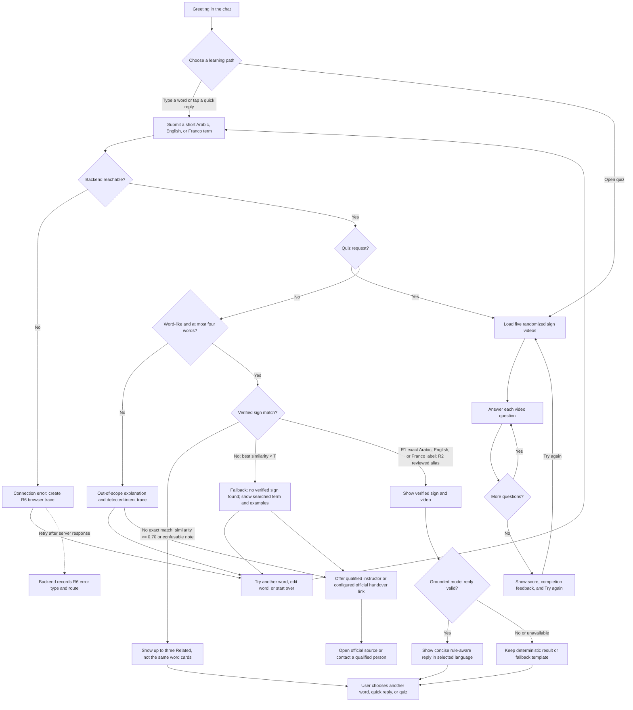

# Week 5: Flow and Architecture

## 1. Conversation Flow

The fallback used by the backend is: `لا توجد مطابقة موثقة لعبارة "{word}" في مجموعة البيانات. هذا لا يعني أن الإشارة غير موجودة. جرّب أحد الأمثلة أو اسأل مختصًا.` The recovery actions are `جرّب كلمة أخرى`, `عدّل الكلمة`, `ابدأ من جديد`, and `اسأل مختصًا`; system errors also provide `حاول مرة أخرى`, which resubmits the failed word. Chat timeouts create an R6 trace in browser storage when the backend cannot respond; API exceptions and Gemini failures record an error type in the backend trace.

Similarity uses normalized character-string comparison with `T = 0.70`; it is not semantic similarity. A related card is never presented as the answer. When there is no indexed relation note, its reason is `related but not the same word`. To add a reviewed note to an entry in `signs.json`, use `"relations": [{"term": "<input term>", "note": "<team-written reason>"}]`.

## 2. System Architecture

See [ARCHITECTURE.md](ARCHITECTURE.md) for the architecture diagram. It marks the decision trace and `Why this result?` panel as the Explainability principle feature. The trace stores the rule, candidates, scores, safeguards, and model status; Gemini may rephrase R1–R4 responses using supplied facts, while deterministic templates remain the fallback.

## 3. Shneiderman's Eight Golden Rules

| Rule | Screen or flow decision in Ishara |
| --- | --- |
| Strive for consistency | Search results use the same chat bubble, result card, label, and video controls. Arabic messages use RTL direction. |
| Enable shortcuts | Four quick-reply chips fill and submit common searches; quiz retry loads another randomized set. |
| Offer informative feedback | The result card identifies the match type and displays Arabic, English, Franco-Arabic, and the verified sign video. The quiz shows progress and score. |
| Design dialogs that give closure | Quiz completion shows the final score and a `Try again` action. A search result ends with the requested sign and its video. |
| Prevent errors and handle them simply | Empty chat input is blocked; the API limits input length; unknown terms and connection failures receive clear fallback messages and recovery actions. |
| Permit easy reversal of actions | `عدّل الكلمة`, `جرّب كلمة أخرى`, and `ابدأ من جديد` let the learner revise or reset a search; quiz `Try again` restarts. |
| Support the user's sense of control | The learner chooses what to search, when to play or maximize video, whether to retry, and whether to open the expert handover. |
| Reduce short-term memory load | Quick replies and the result card keep examples, both written-language labels, and the video visible together. |

## 4. First Backend Model Response

Gemini is called by the FastAPI backend through `backend/app/llm/gemini.py`; the API key stays on the backend. A prior `/chat` response supplied during development reported `model.used: true`, but its generated reply was only `أ`. That confirms an earlier backend call, not a successful demonstration of the current grounded prompt.

**Check-in evidence still needed:** restart the current backend, submit a known sign, and capture the live response or a short recording showing `model.used: true` and a relevant rule-aware `model_reply`; for R1/R2 it should name the verified sign. Do not present the earlier one-letter output as the final model demo.

## Appendix A: Prompt Log

The earlier test dates were not captured, so these entries are recorded by iteration rather than assigned invented timestamps.

| Entry | Prompt/version | Input and observed result | Evaluation |
| --- | --- | --- | --- |
| A1: Generic acknowledgement | Earlier prompt asked for a friendly Arabic acknowledgement without passing the matched sign as context. | Query resolved to `عيب`; observed reply: `أهلاً بك دوماً يسعدني جداً مساعدتك اليوم`. | Failed relevance: generic greeting did not help the learner with the returned sign. |
| A2: Over-constrained short reply | Follow-up prompt requested a short Arabic acknowledgement with a very small output allowance. | Observed model reply: `أ`. | Failed completeness: response was a fragment. |
| A3: Grounded learning reply | Current prompt in `backend/app/llm/prompts.py`: “Write one short, useful Egyptian Arabic reply for a sign-language learning app. Return only JSON matching the schema. Mention the exact Arabic sign term provided. Stay tied to that result: say it was found in the sign library and tell the learner to view or practice with its video. Do not explain the sign's meaning or movement, invent facts, offer unrelated greetings, or mention the AI/model. Use four to fourteen Arabic words and no English or URLs.” | Backend passes the rule, requested language, searched term, and applicable verified labels as context. | The response validator checks language, catalog grounding, and R3/R4 clarity; recent replies are screened for repetition. If validation fails, the deterministic rule template is shown. A fresh live result after this revision is pending capture. |

The model call runs for R1–R4 from the backend. If the model is unavailable or its reply fails validation, Ishara displays the deterministic rule template alongside the catalog-backed result.
